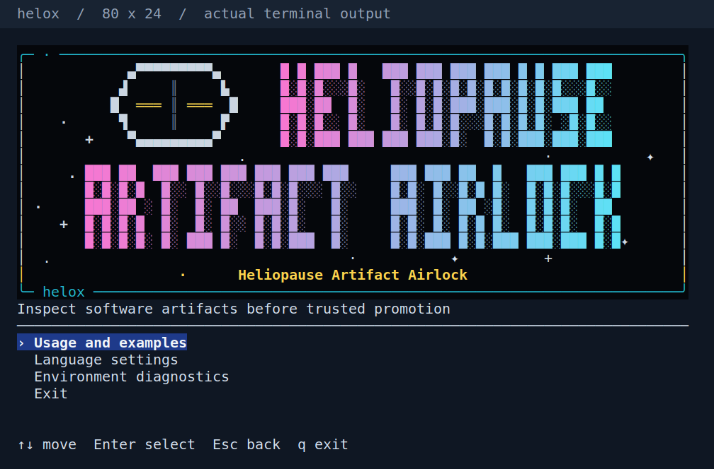

# CLI 시작 화면 아트 — 확정 디자인

Status: COMPLETE — IMPLEMENTED=YES / WIRED=YES / QUALIFIED=YES / ACCEPTANCE_CLOSED=YES (확정 아트의 local 표시 범위). Owner: M13-004 표시 전용 substep.
사용자가2026-11-01 단순 문 시안을 최종 선택했다. 아래 디자인을 고정하며 이름·runtime·배포 계약은 변경하지 않는다.

## 확정한 화면

- 작은 문 로고는 `HELIOPAUSE` 바로 왼쪽에만 둔다. `ARTIFACT AIRLOCK`은 두 번째 줄에서 전체 폭을 사용한다.
- 원래5행 글자 격자와 전체 제품명을 유지하고, 분홍→보라→하늘빛의 가로 그라데이션을 적용한다.
- 검은 브랜드 영역의 빈 여백에 크고 작은 고정 별빛을 배치한다. 글자와 문을 덮지 않는다.
- 문은19×5 단색 윤곽·회색 중앙 분할선·좌우의 짧은 노란 손잡이로만 표현한다.
- 큰 gear·입체/금속 shading·texture·우측 text column과 세 가지 runtime 모드는 사용하지 않는다.

[넓은120×30 화면](./art-simple-wide-20261101.png) · [문 심볼 확대](./art-simple-door-20261101.png)

위 PNG는 승인된 같은 소스의 실제 `launcher.draw` 출력을 고정 font/팔레트로 내보낸 미리보기다.
설치본 screenshot이나 모든 terminal의 정확한 색 재현을 뜻하지 않는다. 사용자 참고 이미지는 제품 자산으로 복사하지 않았다.

## Baseline과 기존 owner

Baseline commit: `e975e5c1fa0cb4de420e7870775baa01b732a42d`.

| 책임 | IMPLEMENTED | WIRED | QUALIFIED | ACCEPTANCE_CLOSED | 근거 / 남은 일 |
| --- | --- | --- | --- | --- | --- |
| TTY 진입·입력·언어·네 메뉴·화면 복원·fallback | YES | YES | YES | YES | 기존 launcher/terminal adapter와 CLI-UX-003를 재사용; 동작 재구현 없음 |
| 기존 글자 grid·geometry·색 선호 | YES | YES | YES | YES | 기존 wordmark/paint/bounds·NO_COLOR 회귀 재사용 |
| 확정한 아트/그라데이션/별 배치 | YES | YES | YES | YES | 사용자 최종 선택·frozen Quick/security/docs PASS; 실제 draw·기존 NativePTY/bounds/color 회귀 |

Read: [표현 계약](../../../user-journey-cli-ia/05-terminal-presentation.md), [기존 baseline](./baseline-20261020.md), [기존 qualification](./qualification-20261020.md), [고정 도구/profile](../../../engineering/03-quality-toolchain.md), [코딩 규칙](../../../engineering/02-coding-security-rules.md).

## 최소 변경과 검토 경계

Production 변경은 `internal/cli/launcher_brand.go`와 `launcher.go`의 기존 brand paint 호출 한 곳이다.
Plain text로 폭/높이를 계산한 뒤에만 RGB를 붙이고 기존 `presentation.paint`가 색상 선호를 계속 소유한다.
고정 문자·내부 계산만 사용하며 외부 입력을 SGR/명령으로 실행하지 않는다. 매 painted segment는 reset된다.
그림자·별·심볼은 고정된 작은 범위이며 animation/timer·네트워크·프로세스·font/전역 palette 변경을 추가하지 않는다.
작거나 낮은 화면·작업 페이지의 compact 표시, 네 메뉴와 footer를 보존한다.

새 package/interface/dependency나 범용 renderer를 도입하지 않았다. 불필요해진7행 offset/추가 높이 guard는 제거했고 기존5행 loop를 쓴다.
외부 TAAG/oh-my-logo/ASCII Motion을 실행 dependency로 추가하지 않았다. 폐기된 시안의 pixel 제작기는 private prototype으로만 남겼다.

## 재현 소스와 검증

확정 후 아래 두 Go 파일은 수정하지 않는다.

| 파일 | SHA256 |
| --- | --- |
| internal/cli/launcher_brand.go | a22bd7ce6b115191aca844ad227b16b3ef3b4a1b77025fd1bb75d613dba075b7 |
| internal/cli/launcher.go | 9bab7ef977edbecd357e970ffb4233e93f386d55f4b7be0a4781138b9b95ac91 |

최종 Go1.27.3 canonical Quick93.086s와 security21.332s가 raw-free candidate에서 한 번의 묶음으로PASS다. Quick은 format/build/test-build/vet/고정 Staticcheck/default를 포함하며 기존 launcher geometry/7언어/색상/NativePTY도 실행했다. 실행 전후 승인된 두 Go source SHA가 동일하다. 문서 내용의 canonical docs0.366s도PASS이며 완료 상태 전달은 같은 profile로 마지막 확인한다.
이전 초안 Quick/표적·부분 성공을 최종 소스의 결과로 전용하지 않는다. module/compiler·runtime/CPP·권한 경계는 그대로여서 full/native/CPP/CUDA/CI를 반복하지 않는다.
현재 macOS hosted 재실행·설치본 교체·main merge/tag/publish의 성공을 주장하지 않는다. 최종 로그와 source 지문은 local `final` 및 `docs/github-logs/cli-art-20261101`에 보존한다.

## 선택 이력과 남은 범위

초기 색·형태/3크기 비교 시안은 사용자 피드백을 반영해 superseded다. 이번 작업에서 만든 미추적 초안18개 PNG와 이전 인계 Markdown은 원본 bytes/hash를 유지해 raw의 `drafts/`로 옮겼다. 선택된3개 PNG만 현재 문서에 유지한다. 사용자 원본과 관련 없는 미추적 자료는 변경하지 않았다.

시각 결정과 해당 local acceptance를 완료했다. 이 표시 작업의 MISSING은 없다. 최종 문서 전달·commit 결과는 같은 변경의 commit 본문과 raw closure receipt에 기록한다.
M13-004 전체의 이름/publisher binding·채널·현재 서명 배포/Host 전환은 별도다.
